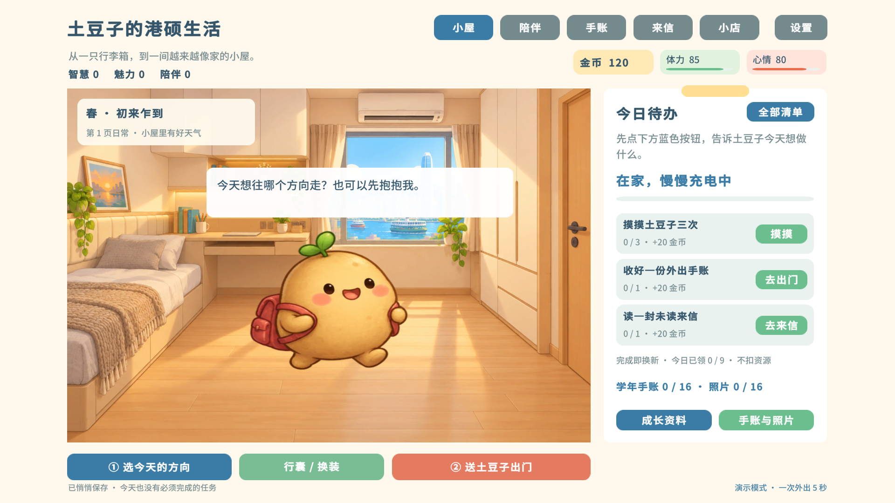

# 土豆子的港硕生活

一款 Unity + C# 开发的中文单机放置陪伴游戏。你来选方向，土豆子自己出门，把香港的日常带回成照片、信件和小惊喜。

**v0.1.4 可玩原型**：完整春夏秋冬、16 次外出的学年纪念、4 种温暖结局；新增陪伴学习（45 分钟起身提醒）、完成即换新的每日任务、自己的待办清单、「素白良物」家居小店、五间可选的房子（含需解锁的海景大平层和山顶别墅）、可用鼠标拖动摆放的家具、三句预设回信和需要亲手拆开的明信片。默认一次外出 5 秒，适合首次试玩和课堂演示；可切换到现实 30—120 分钟的慢生活模式。



**v0.1.4**：新增故事「阿晴的周末邀请」（三种安排、行囊片段、途中消息、回信与回响、故事纪念），真实香港照片做成的横版城市明信片（左图右文、背面、大图），可挂照片的旅行相框，以及按实际游玩记录生成的毕业「这一年的手账」。详见 [CHANGELOG.md](CHANGELOG.md)。

## 下载试玩

**2026-10-24 已更新源码与试玩包**：Mac 下载文件仍名为 `PotatoHK-Mac-v0.1.3.zip`，包内实际版本为 **v0.1.4**；浏览器请下载 `PotatoHK-Browser-v0.1.4.zip`。本轮新增阿晴的周末邀请、城市明信片、港硕必备小店、旅行相框与毕业手账，详见 [本次迭代与运行说明](docs/RELEASE-2026-10-24.md)。

[发行包与运行说明](https://github.com/hwen25211-a11y/potato-hk-life/releases)

- Mac：下载 Mac 试玩 ZIP，完整解压，打开 `土豆子的港硕生活.app`。
- Windows / 浏览器：下载 Browser 试玩 ZIP，安装 Python 3 后使用包内启动器，在浏览器访问 `http://127.0.0.1:8918`。
- GitHub 自动生成的 `Source code (zip)` 是源码，不含构建结果。试玩不需要安装 Unity。

## 怎么玩

第一次只教三件事：选今天的方向 → 送土豆子出门 → 回来收好手账并打开相册。

- **四种方向**：学习、游玩、打工、交朋友。约 60% 的行程跟随偏好，其余是温和的意外。
- **离线陪伴**：连续外出可积攒最多三份收获，不会因离开游戏而丢失照片或错过考核。关闭连续外出后，每趟由玩家主动送出门。
- **照片与朋友**：12 个不同地点的照片、4 张节日纪念、3 位朋友各 3 封心事。同一故事章节只投递一次，回复后再推进下一章；其他外出会带回日常小纸条。照片保留拍摄时的服装。
- **小屋与行囊**：多类家居与生活用品，最多摆放 8 件；便当、相机和雨伞可反复携带。金币仅在主动购买时花费，没有租金或自动扣款。
- **轻松互动**：摸摸土豆子、收任务奖励、装饰房间。体力低会在家自动恢复，没有挂科、效率惩罚或坏结局。
- **今日待办**：右侧便签集中显示三项可选每日任务、当前进度和领取入口。香港时间 0 点刷新，每项奖励 20 金币与心情 +3，未完成不扣资源；抵港小目标也集中在「全部清单」里。
- **四季纪念**：每 4 次收获进入下一季；第 2/6/10/14 次解锁节日故事与衣服。16 次后翻毕业手账，按这一年的生活形成可选方向，结业后仍能继续陪伴。

主界面常驻体力、心情、金币，以及智慧、魅力、陪伴数值，资料卡保留详细成长记录。所有时间与收益数值集中在 `Tuning` / `World`，用于当前原型试玩。

节日按春夏秋冬主题解锁，不采用现实年份日期或真实天气；没有限时错过的惩罚。

## 指定音乐

已接入用户提供的六首原始 MP3，按场景顺序轮播。每个游戏实例使用一个背景音乐播放源：外出时先淡出并停止小屋音乐，再淡入活动音乐；返回后恢复小屋歌单。设置里显示当前曲名，可点击「下一首」；再次进入同一场景时接着播放列表中的下一曲：

| 场景 | 曲目 | 资源 |
| --- | --- | --- |
| 小屋白天 | Mellow Lounge → 午后慢摇爵士曲 → 像素小房间钢琴曲 | `Day` / `AfternoonJazz` / `PixelRoomPiano` |
| 外出与节日 | Winding Path → 午后慢摇爵士曲 → 慵懒松弛冷爵士 | `Travel` / `AfternoonJazz` / `LazyCoolJazz` |
| 小屋夜晚（设备时间 20:00—06:00） | Midnight Rhyme → 慵懒松弛冷爵士 → 像素小房间钢琴曲 | `Night` / `LazyCoolJazz` / `PixelRoomPiano` |

窗口失去焦点时暂停音乐和音效，回来后继续播放；浏览器另有输出静音保护和同源窗口接管，避免打开多个游戏页面时叠歌。设置页底部显示版本号。

以上资源均在 `Assets/Resources/Audio` 下，以 `.mp3` 保存。背景音乐和提示音可分别调音量。原始文件名、媒体信息和 SHA-256 在 `Licenses/UserMusic.json`，来源说明在 `Licenses/Music.txt`。

按钮轻点、金币到账、购物、翻页和拆信使用经过低通、淡入淡出及音量处理的 [Kenney Interface Sounds](https://kenney.nl/assets/interface-sounds) 与 [Casino Audio](https://kenney.nl/assets/casino-audio) CC0 素材；返回小屋、陪伴和纪念反馈采用原创柔和音符。来源与原始许可保存在 `Licenses`，可用 `Tools/make_audio.py` 重新生成；脚本不会播放音频或覆盖指定音乐。

## 开发

用 Unity Hub 打开仓库根目录，使用 **Unity 2022.3.62f3c1**，场景为 `Assets/Scenes/PotatoHome.unity`。依赖 uGUI 1.0.0、TextMeshPro 3.0.6，中文字体已内置。

```sh
./Tools/test-rules.sh
./Tools/build.sh mac
./Tools/build.sh web
python3 Tools/package.py
```

Unity 编辑器菜单“土豆子的港硕生活”也提供构建入口。构建脚本支持 `UNITY_BIN`，规则测试支持 `UNITY_ROOT`。

本机验证保持静音：`PotatoSmoke.Run` 会在任何音频启动前静音测试实例。浏览器测试使用 `http://127.0.0.1:8919/?silent-test=1`（先在 8919 启动预览服务），原生测试使用 `-potato-silent-test`。这些开关不会改变系统音量或玩家保存的音量设置。音频专项回归入口为 `PotatoLife.Editor.PotatoAudioCheck.Run` 和 `Tools/test-web-audio.cjs`（需要 Playwright）；后者强制使用静音无头浏览器。

| 文件 | 职责 |
| --- | --- |
| `PotatoModel.cs` | 可序列化状态、地点、物品和调节参数 |
| `PotatoRules.cs` | 可注入时间的外出、离线、收获、朋友与学年逻辑 |
| `PotatoSave.cs` | 独立版本存档、校验与备份恢复 |
| `PotatoGame.cs` / `PotatoPages.cs` | 常驻场景、局部状态刷新与各页面 |
| `CozyUI.cs` | uGUI/TMP 控件、角色图集、平滑条与轻量动画 |
| `PotatoSound.cs` | 场景歌单轮播、手动切歌、淡入淡出、分离音量 |
| `Assets/Editor` | 构建、纯规则与界面交互检查 |

存档键和应用标识均与旧《港硕这一年》分离。旧项目没有迁移或覆盖；复用审核见 [docs/REUSE-AUDIT.txt](docs/REUSE-AUDIT.txt)，实际验证见 [docs/VALIDATION.txt](docs/VALIDATION.txt)。

本游戏旧存档中的重复故事来信会自动合并，已有属性和奖励不会改变；重复信上的回复保存在信件详情的「看看以前的回复」中。

## 资源与协作

新美术统一使用土豆角色与手绘场景，生成提示词见 `docs/ART-PROVENANCE.txt`。沿用的 Noto Sans SC 派生字体遵循 SIL OFL；TMP 保留自带许可。音乐版权归原权利人，不因仓库公开而变成 CC0。项目未额外指定整个游戏的开源许可证。

提交源码与 `.meta`，不提交 `Library`、`Build`、`release`、存档、凭据及 `LocalReferences`。新需求原文和旧项目的私有设计文档不进入公开仓库或发行包。协作请通过功能分支和 Pull Request，避免同时编辑同一大资源。
